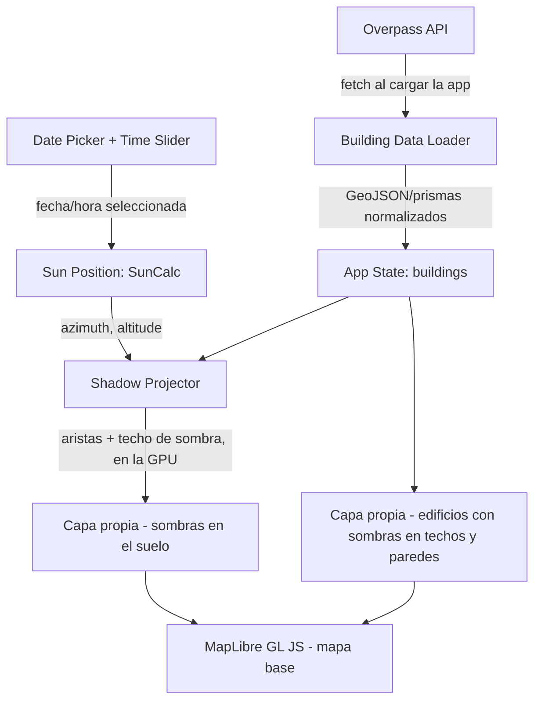

# Plan MVP: Sol y sombras en Palermo

## Estado de avance

- [x] Task 1: Setup del proyecto y mapa base vacío (26/09/2026)
- [x] Task 2: Capa de edificios 3D con datos cargados a mano (26/09/2026, replanteada sin deck.gl)
- [x] Task 3: Edificios reales de Palermo desde OSM (26/09/2026, como snapshot local)
- [x] Task 4: Edificios en 3D (absorbida por la Task 2)
- [x] Task 5: Posición solar y sol visible en la escena (26/09/2026)
- [x] Task 6: Sombras proyectadas (26/09/2026)
- [x] Task 7: Controles de fecha y hora (26/09/2026)
- [x] Task 8: Pulido y casos borde (26/09/2026)
- [x] Task 9: Edificios del Tejido Urbano del GCBA y sombras en la GPU (26/09/2026, agregada después del MVP)
- [x] Task 10: Datos fuera del repo y carga de edificios por zonas (19/10/2026)
- [x] Task 11: Sombras sobre techos y fachadas (19/10/2026)

**Las tareas del MVP están hechas.** Falta:

- Probar la app a mano en una computadora (y ojalá en un celular) con `npm run dev`. La verificación automática usó Chrome headless con un renderizador por software, que no dice nada de la velocidad en una placa de video real: ver "Sin verificar" en la Task 11.
- Hacer el primer commit. Todo está sin commitear.

Las decisiones tomadas en el camino están en el [Registro de decisiones](#registro-de-decisiones), al final.

## Cómo correrlo

Requiere Node 20 o superior.

```bash
npm install
npm run fetch:buildings   # genera los edificios en public/data/ (no viajan con el repo): descarga ~1 GB a .cache/ la primera vez
npm run dev      # servidor de desarrollo en http://localhost:5173
npm test         # tests unitarios
npm run build    # chequeo de tipos + build estático en dist/
npm run fetch:buildings:osm   # alternativa: edificios de OpenStreetMap, en public/data/palermo-osm (apuntar `dataPath` de src/config.ts ahí)
```

Sin los datos generados la app abre igual, pero sin edificios ni sombras. Para publicar con los datos en otro servidor: subir `public/data/` ahí (con CORS habilitado para el sitio de la app) y compilar con `VITE_DATA_BASE_URL=https://mi-servidor/ruta/ npm run build` (ver `.env.example`).

## Problem Statement

Crear una aplicación web que muestre un mapa 3D de una zona de Buenos Aires (Palermo) con los edificios modelados como prismas simples, permitiendo mover un sol virtual según fecha y hora (mediante slider + date picker) y ver en tiempo real las sombras proyectadas por esos edificios sobre el terreno. El MVP no incluye lugares gastronómicos/cowork, integración con Google Maps, ni sistema de usuarios/votos — eso queda para iteraciones futuras.

## Requirements

- Plataforma: web, cliente puro (sin backend propio).
- Zona de cobertura: Palermo, Buenos Aires (bounding box acotado).
- Fuente de datos de edificios: OpenStreetMap (vía Overpass API), tratados como prismas (huella + altura uniforme). *(Desde la Task 9: Tejido Urbano del GCBA, con OSM como alternativa.)*
- Cálculo de posición solar: librería SunCalc, en base a fecha/hora + lat/lng de Palermo.
- Sombras: proyección geométrica 2D (polígono proyectado a partir de azimut/elevación), no shadow-mapping 3D real.
- UI: mapa 3D navegable (pan/zoom/tilt/rotate), slider de hora (0-24hs) y date picker separados, que mueven el sol y recalculan sombras en tiempo real.
- Criterio de éxito: ver el mapa 3D de Palermo con edificios como prismas, mover los controles de tiempo y ver las sombras cambiar dinámicamente.

## Fuera de alcance del MVP (mejoras futuras)

- Lugares gastronómicos/cowork y su clasificación por luz solar directa.
- Integración con Google Maps Platform (Places, listas guardadas, Photorealistic 3D Tiles).
- Sistema de login (Google OAuth o cuenta local) y votos/opiniones de usuarios.
- Cobertura fuera de Palermo / toda CABA.
- Sombras detalladas (retiros, techos inclinados, balcones) o shadow-mapping 3D real.
- *(Hecho en la Task 11)* Sombras sobre techos y fachadas de otros edificios.
- Si se amplía mucho la zona (toda CABA tiene ~1,4 millones de volúmenes), cargar los edificios por partes según la vista en vez de un único archivo.
- Versión móvil nativa.
- Backend propio (cacheo de edificios pre-procesados, persistencia).
- Edificios construidos después de 2021: el Tejido Urbano llega hasta ese año. Se podrían sumar desde OSM o cargarlos a mano.
- Patios internos de los edificios (hoy se modelan como prismas macizos).
- Distinguir en el mapa los edificios con altura supuesta (hoy solo se informa cuántos son).

## Background (investigación realizada)

- **Overpass API**: acepta queries Overpass QL vía POST a `https://overpass-api.de/api/interpreter`, devuelve JSON con `elements` (ways/nodes) incluyendo geometría (`out geom`) y tags. Se puede filtrar por bounding box y `building=*`.
- **Alturas de edificios en OSM**: los tags `height` (metros, incluye techo) y `building:levels` (pisos, sin techo) son de facto estándar. Cuando falta `height` pero hay `building:levels`, aproximar con `levels * 3m` (altura de piso default documentada en la wiki de OSM). Cuando faltan ambos, usar un valor de fallback fijo (sugerido: 9m ≈ 3 pisos, ajustable).
- **SunCalc** *(corregido en la Task 5)*: en la versión 2.x, `getPosition(date, lat, lng)` devuelve `{altitude, azimuth}` en **grados**. `altitude` es la altura aparente sobre el horizonte (0 = horizonte, 90 = cenit) y `azimuth` se mide desde el norte en sentido horario (0 = N, 90 = E). La versión 1.x devolvía radianes con el azimut medido desde el sur, así que no conviene mezclar ejemplos viejos. No tiene dependencias, trae tipos de TypeScript y trabaja con instantes UTC.
- **deck.gl + MapLibre GL JS**: MapLibre GL JS es un fork libre (BSD) y activo de Mapbox GL JS 1.13, sin telemetría ni API key obligatoria. deck.gl soporta integración "interleaved" con MapLibre (renderiza en el mismo contexto WebGL2, permitiendo oclusión real entre capas 3D y el mapa base). `PolygonLayer` (de `@deck.gl/layers`) con `extruded: true` + `getElevation` dibuja los edificios como prismas 3D; el mismo layer con `extruded: false` y `getFillColor` sirve para pintar los polígonos de sombra proyectados sobre el "suelo" del mapa. *(Al final el MVP no usa deck.gl: ver la decisión de la Task 2.)*

## Proposed Solution

Arquitectura cliente-only (sin backend propio):



Flujo:

1. Al cargar la app, se hace un fetch a Overpass API con una bounding box fija de Palermo, pidiendo `way[building]` con geometría.
2. Se normalizan los edificios a una estructura simple: `{ footprint: [[lat,lng], ...], height: number }`, aplicando el fallback de altura (`height` → `levels*3` → default fijo) donde falte el dato.
3. El usuario mueve el slider de hora o el date picker; con la fecha/hora resultante + lat/lng del centro de Palermo se llama a `SunCalc.getPosition()`.
4. Con azimut/elevación del sol, se proyecta cada footprint de edificio: para cada vértice, se desplaza en la dirección opuesta al azimut solar una distancia `height / tan(altitude)` (con casos borde: sol bajo el horizonte → sin sombra o sombra oculta; sol muy alto → sombra mínima).
5. Se renderizan con dos capas propias de WebGL dentro de MapLibre GL JS: una para los edificios (prismas 3D, con las sombras que se tapan entre sí en techos y paredes) y otra para las sombras sobre el suelo. *(En las Tasks 2 a 8 eran capas `fill-extrusion` de MapLibre; ver las Tasks 9 y 11.)*
6. Los controles de UI (slider + date picker) están conectados al estado que dispara el recálculo de los pasos 3-5 en cada cambio.

Decisiones de diseño abiertas (a decidir con criterio razonable durante la implementación, sin bloquear el avance, dejando registrada la decisión tomada):

- Framework de UI: usar Vite + TypeScript; se puede usar vanilla TS o un framework liviano (Preact/React) si simplifica el manejo de estado reactivo de los controles.
- Bounding box exacta de Palermo (usar límites aproximados del barrio de Palermo, CABA).
- Altura de fallback para edificios sin datos de `height` ni `building:levels` (sugerido 9m).

## Task Breakdown

### Task 1: Setup del proyecto y mapa base vacío

- Objetivo: Inicializar el proyecto (Vite + TypeScript), instalar MapLibre GL JS, y renderizar un mapa base centrado en Palermo, Buenos Aires, sin ninguna capa custom todavía.
- Implementación: `npm create vite@latest` (o equivalente), instalar `maplibre-gl`, configurar un estilo base (ej. demo tiles públicos de MapLibre o un estilo vector gratuito sin API key), fijar centro/zoom/pitch inicial sobre Palermo. Agregar un `.gitignore` apropiado para node/Vite.
- Test: smoke test manual (o test de config) que verifica que el mapa se instancia con las coordenadas correctas.
- Demo: abrir la app en el navegador y ver el mapa de Palermo, navegable con mouse (pan/zoom/tilt).
- **Resultado (hecha el 26/09/2026):** proyecto Vite 6 + TypeScript sin framework, con MapLibre GL JS 6 y el estilo "positron" de OpenFreeMap. La cámara arranca sobre Plaza Serrano (zoom 16, inclinación 60°, rotación -20°) y la inclinación máxima es 85°. Tiene controles de navegación y escala, y muestra un mensaje si el navegador no soporta WebGL2. La configuración de la zona está en `src/config.ts`. Se verificó con un test de configuración (bbox, centro, zona horaria) y una captura del build en Chrome headless.

### Task 2: Capa de edificios 3D con datos cargados a mano *(replanteada)*

- Objetivo original: integrar deck.gl sobre MapLibre con una capa de prueba. Se reemplazó por capas nativas de MapLibre (ver Registro de decisiones). El objetivo pasó a ser validar todo el recorrido de los datos (GeoJSON → normalización → prismas 3D) con edificios cargados a mano, antes de meter datos reales.
- Implementación: `src/buildings/` (tipos, normalizador con fallback de altura y carga del GeoJSON) y `src/map/buildingsLayer.ts` (fuente GeoJSON + capa `fill-extrusion`).
- Test: normalizador (alturas, anillos abiertos o degenerados, MultiPolygon, ids) y forma del GeoJSON y de la capa.
- Demo: edificios de muestra en 3D alrededor de Plaza Serrano.
- **Resultado (hecha el 26/09/2026):** `public/data/buildings-sample.geojson` tiene 12 huellas reales cercanas a Plaza Serrano, tomadas de OSM, con alturas cargadas a mano de 6 a 30 m. Se ven como prismas 3D debajo de las etiquetas de calles, y los edificios planos del mapa base quedan ocultos. Hay 15 tests en verde y se verificó con una captura del build en Chrome headless.

### Task 3: Cargar edificios reales de Palermo desde Overpass API

- Objetivo: Reemplazar el polígono de prueba por datos reales: hacer el fetch a Overpass API con la bounding box de Palermo, parsear la respuesta y normalizar cada edificio a `{footprint, height}`.
- Implementación: función `fetchBuildings(bbox)` que construye la query Overpass QL, hace el POST, parsea `elements`; función `normalizeBuilding(element)` que resuelve altura con fallback (`height` → `levels*3` → default).
- Test: tests unitarios de `normalizeBuilding` con casos (con `height`, con `levels` solamente, sin ninguno) usando fixtures de respuesta Overpass.
- Demo: ver los edificios reales de Palermo dibujados como polígonos planos (sin extrusión aún) sobre el mapa.
- **Resultado (hecha el 26/09/2026; desde la Task 9 `fetch:buildings` usa el Tejido Urbano del GCBA y OSM pasó a `fetch:buildings:osm`):** en vez de consultar Overpass cada vez que se abre la app, el script `npm run fetch:buildings` (`scripts/fetch-buildings.ts`) descarga los edificios del bbox de `src/config.ts`. Los convierte con `src/buildings/overpass.ts` y los guarda en `public/data/palermo-buildings.geojson` (1053 edificios, 335 KB, datos OSM al 26/09/2026). La app carga ese archivo con el mismo normalizador de la Task 2. Hay 23 tests en verde (query, armado de contornos de relaciones, filtros, alturas) y se verificó con una captura del build.
- **Cobertura real de los datos:** los edificios mapeados cubren ~7% del bbox (en una zona tan densa lo esperable sería 40-60%). Hay manzanas completas y otras vacías; alrededor de Plaza Serrano la cobertura es de ~4%. De los 1053 edificios, 16 tienen `height`, 564 tienen pisos y 473 (45%) usan la altura por defecto de 9 m. Las sombras van a ser correctas donde hay datos, pero todavía no representan todo el barrio. Ver "Mejoras futuras".

### Task 4: Extruir los edificios en 3D *(absorbida por la Task 2)*

- **Resultado:** con `fill-extrusion` los edificios salen extruidos desde el principio (altura por edificio vía `['get', 'height']`), así que no hizo falta un paso intermedio en 2D. El test del layer está en `src/map/buildingsLayer.test.ts`.
- Objetivo: Renderizar los edificios normalizados como prismas 3D usando `PolygonLayer` con `extruded: true` y `getElevation` mapeado a la altura calculada.
- Implementación: actualizar el layer de edificios con `extruded: true`, `getElevation: d => d.height`, ajustar `elevationScale` si es necesario, dar un color base a los edificios.
- Test: test unitario que verifica que el layer recibe `extruded: true` y la función de elevación correcta.
- Demo: ver los edificios de Palermo como bloques 3D con altura variable, navegables con tilt/rotate del mapa.

### Task 5: Calcular posición solar con SunCalc para una fecha/hora fija

- Objetivo: Integrar SunCalc para calcular azimut/elevación del sol dado un `Date` y las coordenadas del centro de Palermo, primero con un valor hardcodeado (ej. "ahora") antes de conectar los controles de UI.
- Implementación: instalar `suncalc`, función `getSunPosition(date, lat, lng)` que wrappea `SunCalc.getPosition` y devuelve azimut/elevación en grados (convertidos de radianes).
- Test: test unitario comparando contra valores conocidos (ej. mediodía solar en una fecha/ubicación específica).
- Demo: loggear en consola (o mostrar en UI provisoria) azimut/elevación calculados para una fecha fija.
- **Resultado (hecha el 26/09/2026):** `src/sun/sunPosition.ts` calcula la posición del sol, el recorrido del día y la salida y puesta. `src/sun/time.ts` convierte entre la hora local de la zona y los instantes UTC. El sol se ve en la escena 3D con su recorrido del día (`src/map/sunLayer.ts`) y la luz del mapa sigue al sol, así que las fachadas que lo miran se ven más claras (`src/map/sunLight.ts`). Por ahora se calcula para "ahora" y los valores se muestran en la consola. Hay 43 tests en verde: solsticios (altura al mediodía solar dentro de ±0,5° de lo esperado, sol al norte), salida por el este y puesta por el oeste en el equinoccio, noche, zona horaria de Buenos Aires y zonas con horario de verano. Se verificó con una captura a las 16:45: el sol queda al oeste-noroeste a 25° de altura.

### Task 6: Proyectar y renderizar las sombras de los edificios

- Objetivo: Implementar la función de proyección de sombra (por cada footprint + altura + azimut/elevación solar, generar el polígono de sombra proyectado) y renderizarlo con un segundo `PolygonLayer` (plano, semi-transparente) para la fecha/hora fija de Task 5.
- Implementación: función `projectShadow(footprint, height, azimuth, altitude)` con manejo de casos borde (sol bajo el horizonte, sol casi cenital); nuevo layer `shadowLayer` con `extruded: false`.
- Test: tests unitarios de `projectShadow` con casos geométricos simples (cuadrado conocido + ángulos conocidos → sombra esperada).
- Demo: ver las sombras de los edificios de Palermo proyectadas sobre el mapa para una hora/fecha fija, coherentes con la posición del sol.
- **Resultado (hecha el 26/09/2026):** `src/shadows/projectShadow.ts` calcula la sombra exacta de cada prisma en el suelo, y `src/map/shadowsLayer.ts` la dibuja debajo de los edificios. Hay 54 tests en verde: dirección y largo con el sol al norte y al este, noche, tope de largo, cuadrado con la caja esperada, piezas cerradas y antihorarias, y una huella en L cuyo hueco no se sombrea. Se verificó con una captura a las 16:49 (sol a 286°, 24° de altura): las sombras caen hacia el este-sudeste con un largo de ~2,2 veces la altura y no se oscurecen donde se superponen.

### Task 7: Conectar el date picker y el time slider al recálculo dinámico

- Objetivo: Agregar los controles de UI (input de fecha + slider de hora 0-24hs) y conectarlos para que cada cambio dispare recálculo de posición solar (Task 5) y reproyección de sombras (Task 6) en tiempo real.
- Implementación: componentes de UI simples (HTML input type="date" + input type="range", o equivalentes en el framework elegido), estado central que combina fecha+hora en un solo `Date`, listener que recalcula y actualiza los layers.
- Test: test de integración (o manual guiado) que verifica que mover el slider cambia el azimut/elevación calculado y por lo tanto la geometría de sombra.
- Demo: mover el slider de hora y ver las sombras rotar/alargarse en tiempo real; cambiar la fecha y ver el cambio correspondiente en el ángulo solar (ej. sombras más largas en invierno).
- **Resultado (hecha el 26/09/2026):** hay un panel arriba a la izquierda con la fecha (selector nativo), la hora grande y un slider de 0 a 23:55 en pasos de 5 minutos. Abajo muestra la posición del sol en texto ("Sol al E (94°), a 39° de altura") y la salida y la puesta. Cada movimiento recalcula el sol, la luz y las sombras en vivo. La orquestación está en `src/app/sunScene.ts` y los controles en `src/ui/`. Hay 62 tests en verde (puntos cardinales, textos del panel, redondeo del slider). Se verificó moviendo los controles en Chrome headless:
  - 21/12 a las 09:00: sol al este a 39°, sombras hacia el oeste, sale 05:37 y se pone 20:06.
  - 21/06 a las 13:00: sol al norte a 32°, sombras largas hacia el sur, sale 08:00 y se pone 17:50.
  - 26/09 a las 22:00: sin sol ni sombras, con el aviso "El sol está bajo el horizonte".
  - Recalcular las sombras de los 1054 edificios (7442 piezas) tarda ~1,7 ms por actualización.

### Task 8: Pulido visual y manejo de casos borde

- Objetivo: Cerrar el MVP con manejo prolijo de casos borde (sol bajo el horizonte → sin sombras o noche visualmente distinta, edificios sin datos de altura → fallback aplicado consistentemente) y ajustes de estilo (colores, leyenda mínima, loading state mientras se bajan los edificios).
- Implementación: chequeo `altitude <= 0` para ocultar sombras de noche, indicador de carga durante el fetch a Overpass, ajuste de paleta de colores para edificios/sombras.
- Test: test unitario del caso `altitude <= 0`, test manual del loading state (throttling de red).
- Demo: recorrido completo del MVP: cargar la app, ver el loading, ver Palermo en 3D, mover fecha/hora incluyendo pasar de día a noche, y confirmar que el comportamiento es estable y visualmente claro — este es el criterio de éxito definido para el MVP.
- **Resultado (hecha el 26/09/2026):**
  - **Noche:** al ponerse el sol no hay sombras. Durante el crepúsculo civil (sol entre 0° y −6°) aparece de a poco un velo azul oscuro sobre el mapa, que no tapa los controles (`src/map/nightOverlay.ts`), y la luz pasa a ser fría y suave desde arriba (`NIGHT_LIGHT` en `src/map/sunLight.ts`).
  - **Carga:** el panel muestra "Cargando mapa y edificios…" en una región `role="status"` y los controles quedan deshabilitados hasta que todo está listo.
  - **Errores:** si no carga el archivo de edificios, la app sigue funcionando con el sol y la hora, sin sombras, con los edificios planos del mapa base y un aviso en rojo. Si falla el mapa base, también se avisa en el panel.
  - **Leyenda y datos:** referencias de edificio, sombra y sol, y una nota: "1.054 edificios de OpenStreetMap · 473 sin altura cargada (se asumen 9 m)".
  - **Tests:** 68 en verde (velo nocturno, luz nocturna, nota de datos).
  - **Verificado** en Chrome headless con el build de producción: carga con el archivo de edificios demorado a propósito, error con el archivo bloqueado, crepúsculo (19:10), noche (22:00), celular (390 × 844) y día (11:00).
  - **Sin verificar:** el arranque con `npm run dev` (la prueba se interrumpió) y el uso real con mouse o touch. Los controles se probaron disparando los mismos eventos `input` que genera el navegador.

### Task 9: Edificios del Tejido Urbano del GCBA *(agregada después del MVP)*

- Objetivo: reemplazar OSM, que cubría ~7% del área, por el dataset "Tejido Urbano" del GCBA como fuente de edificios.
- **Resultado (hecha el 26/09/2026):**
  - **Datos:** `npm run fetch:buildings` (`scripts/fetch-buildings-gcba.ts`) descarga `tejido.geojson` (1,09 GB, 1.386.616 volúmenes de toda la Ciudad). Lo lee en streaming y se queda con los volúmenes del bbox de `src/config.ts`. *(En esta tarea los guardaba en un solo archivo, `public/data/palermo-buildings.geojson`; desde la Task 10 los guarda por zonas.)*
  - **Contenido:** 50.759 volúmenes con altura en metros (fotogrametría, datos hasta 2021), 19 MB. Cubren el 52% del área, contra ~7% de OSM. La altura mediana es 5,6 m, el 90% está por debajo de 25 m y la máxima es 142 m. Todos traen altura, así que ninguno usa la supuesta de 9 m.
  - **Conversión:** `src/buildings/gcba.ts` pasa cada volumen al mismo formato de antes (`height` en metros). El normalizador y la capa de edificios quedaron igual.
  - **Sombras en la GPU:** con 50 veces más datos, el método de la Task 6 tardaba ~180 ms y generaba 88 MB de GeoJSON por cada movimiento del slider. `src/map/shadowsLayer.ts` pasa a ser una capa WebGL: las ~505.000 aristas se cargan una sola vez y cambiar la hora solo actualiza la dirección de la sombra. El costo ya no depende de la cantidad de edificios.
  - **Panel y atribución:** el mapa muestra "Edificios: GCBA – Tejido Urbano (CC BY 4.0)" y el panel, "50.759 volúmenes edificados · Tejido Urbano del GCBA (2021)". *(Desde la Task 10, los dos salen del índice del dataset y no de `src/config.ts`.)*
  - **OSM como alternativa:** `npm run fetch:buildings:osm` escribe en una carpeta aparte.
  - **Tests:** 78 en verde (conversión del GCBA, sistema de coordenadas y aristas para la GPU, y sombra en CPU con la regla nueva).
  - **Verificado** con capturas del build en Chrome headless: 26/09 a las 11:00 (sol al NE a 49°) y 21/06 a las 16:00 (sol al NO a 17°, sombras largas hacia el SE cubriendo casi todas las calles).

### Task 11: Sombras sobre techos y fachadas *(mejora de `mejoras.md`)*

- Objetivo: que la sombra de un edificio alto se vea también cuando cae sobre un edificio más bajo (su techo o su pared), y no solo sobre el suelo. Hasta la Task 10 esa sombra quedaba escondida dentro del volumen del edificio bajo, y no se entendía de dónde venía.
- **Resultado (hecha el 19/10/2026):**
  - **Edificios con capa propia:** `src/map/buildingsLayer.ts` dibuja paredes y techos con shaders propios y reemplaza al `fill-extrusion` de MapLibre, que no permite cambiar su sombreado. Las paredes salen de las mismas aristas que usan las sombras del suelo (una pared por arista) y los techos se triangulan con `earcut` (`src/shadows/roofMesh.ts`).
  - **Techo de sombra:** para cada punto del plano se calcula la altura por debajo de la cual queda a la sombra de algún edificio (`src/shadows/shadowCeiling.ts`, `src/map/ceilingMap.ts`). Con una sola lectura de esa textura, un techo, una pared o el suelo saben si les da el sol. Se calcula en la GPU en ~10 pasadas cada vez que cambia el sol o llegan edificios nuevos.
  - **Qué se ve:** un techo o una pared tapados por otro edificio se tiñen con el mismo azul de la sombra del suelo (40%). Las paredes que dan la espalda al sol también. De día, con el sol a 17° sobre el horizonte, los techos bajos que quedan detrás de una torre aparecen en gris y los demás en beige, igual que el color de la leyenda.
  - **Luz de cielo:** apareció una regresión que no estaba prevista. Sin la luz de MapLibre, de noche y a la sombra techos y paredes quedaban del mismo color y los edificios se veían como siluetas planas. El shader suma una luz de cielo (los techos reciben más que las paredes) y se leen los volúmenes en todas las horas.
  - **Zonas nuevas:** las zonas que llegan después de un cálculo vuelven a disparar el techo de sombra, así que las sombras se completan solas a medida que se cargan los edificios.
  - **Dependencias:** `earcut` 3.2.3 pasa a ser una dependencia directa (ya venía con MapLibre, con la misma versión). También se actualizó `source-map-js` a 1.2.2 por un aviso de seguridad de `npm audit` en una herramienta de compilación.
  - **Limpieza:** se eliminaron `src/map/sunLight.ts` (la luz de MapLibre ya no se usa) y los tests del GeoJSON y de la capa `fill-extrusion`.
  - **Tests:** 147 en verde. Nuevos: techos (áreas y orientación), dirección del sol, el techo de sombra contra el cálculo exacto con 7 posiciones del sol (también en diagonal), los ejes del mapa, y la geometría compartida.
  - **Verificación:**
    - *La GPU contra el cálculo exacto:* una prueba temporal en el navegador corrió el `CeilingMap` real con edificios sintéticos y leyó la textura de vuelta. Con 8 posiciones del sol y ~8.200 puntos cada una, ningún punto quedó fuera del rango esperado, y en el interior de las sombras el error máximo fue de 2 m de altura, dentro de lo que permite la grilla de 1,25 m.
    - *De punta a punta, contra los pixeles:* se calculó por separado, con un método independiente de la app (un rayo hacia el sol que avanza de a 50 cm), si el techo de 5.401 puntos de edificios reales debía estar al sol o a la sombra en 5 fechas y horas distintas, y se comparó con el color del pixel de una captura cenital. Coinciden el **96,8%**. Los desacuerdos van todos en el mismo sentido: la app pinta sombra donde la referencia dice sol. **En ningún caso pinta sol donde hay sombra.** En el análisis de los 180 desacuerdos de una de las corridas, ninguno estaba a más de 2 m de un borde de sombra.
    - *Costo de CPU:* preparar la geometría de los 50.759 volúmenes (aristas y triangulación) toma 216 ms en total, y la zona más cara, 26 ms: menos de un cuadro. La geometría ocupa ~21 MB de memoria de GPU y las dos texturas del techo de sombra, ~29 MB.
    - *Capturas:* invierno a las 12:30 y 16:00, verano a las 09:00, atardecer a las 17:40, crepúsculo y noche.
  - **Sin verificar:**
    - *La velocidad en una GPU real.* El único renderizador que tuve es por software (Chrome headless), donde una cámara girando da ~1 cuadro por segundo, y no sirve para estimar nada de una placa de video. Tampoco tengo una medición de cómo andaba antes de esta tarea. **Conviene probarlo en una computadora y en un celular.**
    - *Navegadores sin texturas de punto flotante* (algunos celulares). El código lo detecta y muestra los edificios sin las sombras que se tapan entre sí, con un aviso en la consola, pero ese camino no se probó.
    - El uso con mouse o touch reales.

### Task 10: Datos fuera del repo y carga de edificios por zonas *(mejoras de `mejoras.md`)*

- Objetivo: que los datos de edificios no viajen con el repo (pueden estar en otro servidor) y que se carguen por partes según lo que mira el usuario, en vez de bajar todo al abrir la app.
- **Resultado (hecha el 19/10/2026):**
  - **Dataset por zonas:** `npm run fetch:buildings` ahora escribe en `public/data/palermo/` un `index.json` (qué zonas hay, qué cubre cada una, de dónde salen los datos y su atribución) y 34 archivos en `tiles/`, de zonas de 500 m. Son los mismos 50.759 volúmenes y 19 MB, y ninguna zona pasa de 1,1 MB. Las zonas chicas son edificios que cruzan el borde del área.
  - **Fuera del repo:** `public/data/` está en `.gitignore`. Los datos se generan con el script (o se bajan del servidor donde se publiquen).
  - **Servidor externo:** con `VITE_DATA_BASE_URL` (ver `.env.example`) la app lee el índice y las zonas desde esa dirección, y `npm run build` deja los datos fuera de `dist/`: 1,6 MB contra 20 MB con datos locales. Subir `public/data/` tal cual a cualquier hosting de archivos con CORS alcanza.
  - **Carga por vista:** la app baja el índice (unos pocos KB) y después las zonas que tocan la vista, de las más cercanas al centro a las más lejanas, de a 4 en paralelo (`src/app/buildingStream.ts`, `src/buildings/chunkLoader.ts`). Cada vez que el usuario termina de mover el mapa se vuelve a calcular qué zonas hacen falta. Con el zoom por debajo de 14 no se piden zonas nuevas.
  - **Panel:** muestra "Cargando edificios… faltan N zonas" y "12.340 de 50.759 volúmenes edificados · Tejido Urbano del GCBA (2021)" mientras llegan. El sol y los controles andan sin esperar a los edificios.
  - **Tests:** 108 en verde (grilla de zonas, reparto de edificios, validación del índice, selección por vista, cargador con prioridad, reintentos y cancelación, y unión de URLs).
  - **Verificado** en Chrome headless, con el build de producción y con `npm run dev`: la carga inicial pide 22 de las 34 zonas (las más cercanas primero) y a los 2,5 s ya hay 48.571 volúmenes en pantalla. Al llevar el mapa al norte, al oeste y al sur pide justo las zonas de ese borde, y fuera del área o con zoom 13 no pide nada. Datos en otro origen con CORS correcto: las 22 zonas cargan sin errores. Con CORS mal configurado, sin datos generados o con una zona que falla, la app avisa en el panel, mantiene el sol y los controles, y carga el resto.
  - **Sin verificar:** un servidor o CDN real (se probó con un servidor local en otro puerto), y el uso con mouse o touch reales.

## Registro de decisiones

Cada decisión indica por qué se tomó y cómo cambiarla si hace falta.

### Task 1

- **Vite 6.4 + TypeScript 7, sin framework de UI.** El Node local es 20.16 y Vite 7+ pide 20.19 o más. Vite 6 tiene soporte y alcanza para este MVP. Para pasar a Vite 8 basta con actualizar Node y la dependencia. El estado de la UI es chico, así que alcanza con TypeScript puro. Si la UI crece, se puede sumar Preact o React sin reescribir la lógica, que queda en módulos independientes.
- **Vitest 4.1.11.** Es la primera versión compatible con Node 20 que corrige la vulnerabilidad GHSA-82fw-gwwq-j7x9 de `@vitest/mocker` (la rama 3.x no va a recibir el parche). La primera instalación necesitó `npm install --legacy-peer-deps` por un bug de npm 10.8 ("edgesOut"). Con el `package-lock.json` ya generado, `npm install` y `npm ci` funcionan sin flags.
- **Mapa base: OpenFreeMap "positron".** Es gratis, no pide API key ni registro y usa datos de OSM. El tono neutro deja que resalten el sol y las sombras. Se cambia en `BASEMAP_STYLE_URL` (`src/config.ts`) por cualquier estilo compatible con MapLibre, por ejemplo `liberty` o `bright` de OpenFreeMap.
- **MapLibre GL JS 6.** Se distribuye solo como ESM y exige WebGL2. Con Vite hay que registrar el worker con `setWorkerUrl` (está en `src/map/createMap.ts`).
- **Zona inicial: Palermo Soho + Hollywood.** Bbox `[-58.445, -34.598, -58.419, -34.579]` (~2,4 × 2,1 km), centro en Plaza Serrano, zona horaria `America/Argentina/Buenos_Aires`. Es el núcleo gastronómico del barrio y mantiene chico el volumen de datos. Todo está en un `AreaConfig`, así que sumar zonas es agregar objetos.
- **`base: './'` en Vite.** El build usa rutas relativas y se puede publicar en cualquier hosting estático o subcarpeta.

### Task 2

- **Capas nativas de MapLibre en lugar de deck.gl.** MapLibre ya extruye polígonos GeoJSON con una altura por edificio (`fill-extrusion`), y eso cubre los prismas. Con un solo motor de render hay menos dependencias y ningún riesgo de integración con MapLibre 6, que es muy reciente y eliminó APIs internas. La idea es usar el mismo mecanismo para las sombras (extrusión translúcida casi plana) y para el sol (extrusión flotante); se valida en las Tasks 5 y 6. Si más adelante hace falta algo que MapLibre no resuelve (mallas 3D, líneas en el aire), deck.gl 9.4 tiene integración con MapLibre (`MapLibreOverlay`) y se puede sumar sin tocar los datos.
- **Un único formato de datos: GeoJSON.** Features Polygon o MultiPolygon con `height` (metros) y/o `building:levels`. Sirve igual para OSM, para el GCBA y para un archivo armado a mano: cargar edificios a mano es dibujarlos en un editor como geojson.io y ponerlos como una zona más de un dataset (ver Task 10).
- **Altura: `height` → `building:levels` × 3 m → 9 m por defecto.** Cada edificio guarda de dónde salió su altura (`heightSource`), para poder distinguir los datos estimados.
- **Solo el anillo exterior.** Los patios internos se ignoran: los edificios son prismas macizos.
- **Los edificios del mapa base se ocultan cuando cargan los nuestros.** Si la carga falla, quedan visibles los planos del mapa base.
- **Los edificios van debajo de las etiquetas**, para que los nombres de las calles sigan legibles.

### Task 3

- **Snapshot local en vez de consultar Overpass al abrir la app.** Las instancias públicas de Overpass se saturan seguido (durante el relevamiento, `overpass-api.de` respondió "too busy") y su política de uso no está pensada para ser el backend de una app. Con el snapshot, la app carga rápido, funciona aunque Overpass esté caído y sigue siendo 100% estática. Para actualizar los datos: `npm run fetch:buildings`. Si más adelante se quiere consultar en vivo, `buildOverpassQuery` y `overpassToGeoJSON` ya viven en `src/` y se pueden usar desde el navegador.
- **Varias instancias de Overpass.** El script prueba `overpass-api.de`, `maps.mail.ru` y `overpass.kumi.systems`, en ese orden, y detecta las respuestas de error que llegan con HTTP 200.
- **`tsx` para correr el script en TypeScript.** Node 20.16 no ejecuta TS de forma nativa. Con `tsx` el script importa el mismo código de `src/` que usa la app: el bbox de la config, la conversión y el normalizador, sin duplicar nada. `npm run typecheck` también chequea `scripts/`.
- **Qué se descarga:** ways y relaciones multipolígono con `building`. Se descartan `building=no` y `building=roof` (techos sueltos, como marquesinas o estaciones de servicio, que no son volúmenes macizos). Los contornos de relaciones partidos en varios ways se unen en anillos cerrados. Se guardan solo los tags `building`, `height` y `building:levels`.
- **Formato del archivo:** GeoJSON estándar con `bbox` y un bloque `metadata` (fuente, fecha de los datos OSM, licencia), con un edificio por línea para que los diffs de git sean legibles. La atribución "© OpenStreetMap contributors" se muestra en el mapa, como pide la licencia ODbL.
- **Se eliminó `buildings-sample.geojson`.** Solo servía para validar la Task 2. Para cargar edificios a mano alcanza con un GeoJSON con el mismo formato (Polygon + `height` en metros).

### Task 5

- **SunCalc 2.0.2.** Trabaja en grados y con azimut desde el norte, que es la convención que usan tanto la luz de MapLibre como la proyección de sombras, así que no hay conversiones en el medio.
- **La hora siempre es la de la zona (Buenos Aires), no la del navegador.** La conversión usa `Intl.DateTimeFormat`, sin dependencias, y contempla el horario de verano para cuando se sumen ciudades que lo tengan. La zona horaria vive en `AreaConfig.timeZone`.
- **El sol se calcula en el centro de la zona.** En 2 km la dirección del sol cambia menos de 0,02°.
- **Sol visible: capa WebGL propia de MapLibre (custom layer).** El sol es un disco con halo, anaranjado cerca del horizonte y blanco cálido cuando está alto. Su recorrido del día se marca con puntos cada 20 minutos. Todo va sobre una "cúpula" centrada en lo que mira la cámara, con un radio del 35% del alto visible, así el sol queda siempre a mano en pantalla sin importar el zoom. La dirección es la real y la cúpula es solo una forma de mostrarla. La capa comparte la profundidad con los edificios, así que un edificio alto puede tapar al sol. Se descartó la extrusión flotante de MapLibre que se había pensado en la Task 2: el sombreado de las extrusiones oscurece el lado del sol que no mira a la luz y deja de parecer un sol.
- **La luz del mapa sigue al sol** (`anchor: 'map'`, azimut del sol, ángulo polar = 90° − altura). Con el sol bajo, los techos se ven más oscuros y las fachadas que lo miran, más claras. La intensidad es la de MapLibre por defecto (0,5); se puede ajustar en `src/map/sunLight.ts`.

### Task 6

- **Sombra exacta del prisma.** La sombra en el suelo es la huella "barrida" en la dirección opuesta al sol (largo = altura / tan(altura del sol)), y es igual a la unión de la huella con un paralelogramo por cada arista. Se usa esa unión en vez de una envolvente convexa porque la envolvente sombrearía de más los patios y los huecos de edificios en L o en U. Así queda lista para responder más adelante "¿este punto está al sol?" con un simple punto-en-polígono. Cuesta n+1 piezas por edificio de n aristas: con ~1000 edificios son ~10.000 polígonos chicos, que MapLibre procesa sin problema.
- **Largo máximo de 500 m** con el sol casi en el horizonte. Pasado ese largo, la calle ya está en sombra de todos modos. Se cambia en `MAX_SHADOW_LENGTH_M`.
- *(Reemplazado en la Task 9 por un render en la GPU.)* **Render como extrusión de altura 0 y translúcida (opacidad 0,4).** Con opacidad menor a 1, MapLibre dibuja las extrusiones en dos pasadas (primero profundidad, después color con stencil), así que cada pixel se pinta una sola vez por capa. Donde se superponen sombras de piezas o de edificios vecinos, el tono queda parejo. Con una capa `fill` común, las superposiciones se verían más oscuras. Las piezas se normalizan a sentido antihorario y se descartan las casi nulas (aristas paralelas a la sombra), para que MapLibre no confunda piezas con agujeros.
- **Un MultiPolygon de sombra por edificio, con su `id`**, para poder vincular cada sombra con su edificio más adelante (resaltar, consultar).

### Task 7

- **Controles nativos del navegador** (`<input type="date">` y `<input type="range">`). No necesitan librerías, funcionan con teclado y en celulares, y son accesibles de entrada. El slider expone la hora legible con `aria-valuetext`, así un lector de pantalla anuncia "16:45" y no "1005".
- **Slider en pasos de 5 minutos (0:00 a 23:55).** Alcanza para ver cómo se mueven las sombras sin que el control sea difícil de manejar. Se cambia en `SLIDER_STEP_MINUTES`.
- **Arranca en la fecha y hora actuales de Buenos Aires**, redondeadas al paso del slider.
- **Un recálculo por cuadro como máximo.** El slider dispara muchos eventos por segundo y se aplica solo el último de cada cuadro (`requestAnimationFrame`). El recorrido del sol y los horarios se recalculan solo cuando cambia la fecha.
- **Salida y puesta calculadas desde el mediodía local.** SunCalc devuelve los horarios del "día solar" que contiene al instante. Cerca de la medianoche, eso podría dar los del día anterior.
- **Panel arriba a la izquierda.** Deja libres los controles de navegación (arriba a la derecha) y la escala y la atribución de OSM (abajo), que tienen que quedar visibles. En pantallas angostas se achica para no tapar los controles.
- **Los controles arrancan deshabilitados** y se habilitan cuando el mapa y los edificios están listos.

### Task 8

- **Noche con un velo en vez de cambiar el estilo del mapa.** Un `div` translúcido dentro del contenedor del canvas oscurece todo el mapa con una sola pieza, anda con cualquier estilo base y deja los controles legibles. Su opacidad sigue a la altura del sol: 0 de día, gradual durante el crepúsculo civil (hasta −6°) y 0,6 de noche. Se ajusta en `MAX_NIGHT_OPACITY`.
- **Luz nocturna fija**, fría (`#b8c2e0`), suave (0,3) y desde arriba. De noche no tiene sentido una dirección de luz.
- **Si fallan los edificios, la app sigue funcionando** en vez de bloquearse. El sol, la hora y el recorrido funcionan sin ellos, y el aviso explica qué pasa.
- **Leyenda mínima y nota sobre los datos.** Dice cuántos edificios usan la altura supuesta, para que se entienda por qué algunas sombras pueden no coincidir con la realidad. Por ahora no se colorean distinto, para mantener el mapa simple (queda en "Mejoras futuras").

### Task 9

- **Se usa el GeoJSON del dataset.** Viene en lng/lat (CRS84), así que no hace falta reproyectar. El shapefile pediría un lector y una reproyección, y el CSV no trae geometría. Como GDAL escribe un feature por línea, el archivo de 1 GB se lee en streaming sin cargarlo entero en memoria. Si ese formato cambia, el script falla en vez de generar un archivo vacío.
- **Cada volumen es un prisma propio.** Un edificio con retiros viene como varios volúmenes de distinta altura, y eso encaja con el modelo existente sin cambios.
- **Las coordenadas van con 6 decimales (~11 cm)** y la descarga completa queda en `.cache/`, que está en `.gitignore`. Como el dataset es histórico (datos hasta 2021), no hace falta regenerarlo seguido. *(Se había decidido versionar el archivo de 19 MB en el repo; la Task 10 lo reemplazó: los datos ya no se versionan.)*
- **Sombras en la GPU.** Cada arista que mira hacia el lado contrario al sol proyecta un cuadrilátero (la arista y su copia desplazada), que es la misma regla de `projectShadow`. Esos cuadriláteros se pintan primero en una textura propia, donde las superposiciones no suman, y después se aplican sobre el mapa con opacidad pareja. Los edificios, que se dibujan después, tapan la sombra que queda detrás de ellos. Este render reemplaza al de la Task 6. `projectShadow` (en CPU) queda como referencia testeada y para consultas puntuales, como "¿este punto está al sol?".
- **Licencia.** El recurso figura como CC BY 4.0 y el paquete como CC-BY-2.5-AR. Las dos piden atribución, que se muestra en el mapa.

### Task 10

- **Zonas propias en vez de vector tiles (PMTiles).** La capa de sombras y la de edificios necesitan la geometría de cada edificio, y con vector tiles MapLibre la guarda en sus propias estructuras, donde no se puede leer con facilidad. Con archivos GeoJSON por zona controlamos qué se carga, y es un formato que se abre en cualquier herramienta (QGIS, geojson.io). No hace falta ninguna herramienta nativa para generarlos. Si más adelante hace falta cubrir toda la Ciudad, PMTiles sigue siendo una opción (ver `mejoras.md`).
- **Zonas de 500 m, repartidas por el centro de la caja de cada edificio.** Así ningún edificio queda en dos zonas. El tamaño sale de ahí: ~2.000 volúmenes y ~750 KB por zona, pocas peticiones y descargas livianas. Se cambia en `DEFAULT_CHUNK_SIZE_M` (`scripts/lib/chunkedDataset.ts`) y la app no necesita cambios, porque lee la caja de cada zona del índice.
- **El índice describe el dataset.** Trae la fuente, la licencia y la atribución, así que cambiar de fuente de datos no exige tocar la configuración de la app. Además lleva `dataVersion`, que se agrega a la URL de cada zona (`?v=…`): si se publica una versión nueva de los datos, nadie recibe zonas viejas de la caché. Se escribe al final: un dataset a medio generar no tiene índice y no se puede usar por error.
- **Se piden las zonas de un cuadrado alrededor del centro de la vista**, con el tamaño de la pantalla agrandado un 30%, y no el área exacta que se ve: con el mapa inclinado, la vista incluye mucho suelo hacia el horizonte y calcularla bien no vale la pena, porque lo lejano ocupa muy pocos píxeles. Si el usuario se acerca, se piden menos zonas.
- **Cada pedido nuevo reemplaza la cola de espera.** Si el usuario ya se movió a otro lado, las zonas que quedaron atrás no se descargan. Lo que ya estaba bajando termina, y nunca se baja dos veces la misma zona. Una zona que falla se reintenta recién pasados 10 s y al volver a mover el mapa, para no machacar un servidor caído.
- **Todavía no se descargan zonas de memoria.** Para un área del tamaño de Palermo (19 MB) no hace falta. Para toda la Ciudad sí (ver `mejoras.md`).
- **Los datos externos necesitan CORS.** El navegador bloquea las lecturas entre orígenes si el servidor no manda `Access-Control-Allow-Origin`. Se probó que, si falla, la app lo avisa en el panel y mantiene el sol y los controles.
- **`import.meta.env` solo en `src/dataUrl.ts`.** Los scripts de datos comparten código con la app pero corren en Node, donde esa variable no existe. Por eso lo que depende del entorno de Vite está aislado en un solo archivo que los scripts no importan.

### Task 11

- **Capa propia de edificios en vez de `fill-extrusion`.** MapLibre no deja cambiar cómo sombrea sus extrusiones, y para que un techo sepa si lo tapa otro edificio hace falta decidirlo pixel por pixel. A cambio se perdió su iluminación, que el shader reemplaza con un modelo simple: luz de cielo (los techos reciben más que las paredes), un poco de luz del sol según hacia dónde mira cada pared, y el tinte azul de sombra. Un techo al sol queda exactamente del color de la leyenda.
- **"Techo de sombra" en vez de un mapa de sombras clásico (shadow mapping).** Los edificios son prismas (un relieve 2,5D), y para un relieve alcanza con una sola cantidad por punto del plano: la altura por debajo de la cual hay sombra. Con una lectura se resuelve el suelo, un techo o una pared. No hay sesgos que ajustar ni el efecto de "acné" del shadow mapping, y como esa altura baja en rampa lineal al alejarse del edificio, el borde de la sombra queda nítido aunque la grilla sea gruesa. Además es justo lo que va a hacer falta para saber si un local, una terraza o una ventana reciben sol (ver `mejoras.md`).
- **El mapa gira para que su eje vertical apunte siempre al sol.** La primera versión era un mapa alineado con el norte, con pasadas que miraban hacia el sol con interpolación. Esa interpolación difuminaba el resultado cuando el sol venía en diagonal, y los tests contra el cálculo exacto lo mostraron: la punta de una sombra de 37 m quedaba 1,8 m más baja de lo correcto. Con el mapa girado cada pasada es un desplazamiento entero de celdas, sin interpolar, y el cálculo da lo mismo para cualquier dirección del sol. El mapa es un cuadrado del tamaño de la diagonal del área para que entre cualquiera sea el giro, y se reutiliza la misma textura para todas las horas.
- **Celdas de 1,25 m y pasadas que duplican el alcance (1, 1, 2, 4… celdas).** Con ~10 pasadas se llega a 640 m, que es más que la sombra del edificio más alto (142 m) con el sol a 15°. Si hace falta menos detalle o menos costo, se cambia en `CEILING_CELL_M` y `MAX_CEILING_REACH_M`; si el área no entra en una textura, las celdas se agrandan solas.
- **Texturas de media precisión (16 bits).** Resuelven 6 cm a 100 m de altura, se pueden interpolar sin extensiones y ocupan la mitad que las de 32 bits. Hace falta que el navegador permita dibujar en texturas de punto flotante; si no, se muestran los edificios sin las sombras entre sí.
- **El contorno de cada edificio se ensancha media celda en el mapa de alturas.** Una pared más angosta que una celda podría no tocar el centro de ninguna y desaparecer. El costo es que las sombras sobre techos y paredes salen hasta ~2 m más gruesas que las exactas, siempre del lado seguro: se mide que nunca se pinta sol donde hay sombra.
- **En las paredes, el techo de sombra se lee 2,5 m hacia afuera.** Junto a la pared, las celdas de adentro valen casi la altura del propio edificio (su contorno ensanchado cuenta como obstáculo) y contaminarían la lectura.
- **Las sombras sobre el suelo siguen siendo las de la Task 9.** Se calculan con las aristas de forma exacta y tienen bordes más nítidos que los del techo de sombra, que tiene la resolución de la grilla. Las dos coinciden en la base de cada pared. La geometría de las zonas ahora se sube a la GPU una sola vez y la comparten las capas (`GeometryStore`).
- **El techo de sombra se vuelve a calcular solo cuando cambia el sol o llegan edificios nuevos**, no en cada cuadro. Mover la cámara no lo toca.
- **`antialias` activado en el mapa.** MapLibre lo trae apagado y los bordes de una capa propia se veían escalonados.
- **Los edificios y el crédito de la fuente de datos van separados.** Como los edificios ya no son una fuente de MapLibre, el crédito de la licencia se muestra con una capa invisible que lleva la atribución (`addDataAttribution`).
